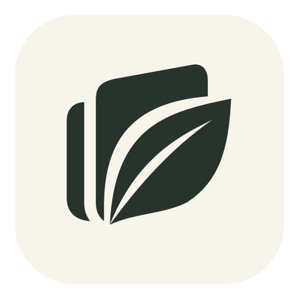

# Leaf



Spotlight finds my config files before my PDF. Leaf is the file search I actually wanted.

Press **⌘⇧Space**, type what you'd say, and get two sections:

- **Name**: files whose name matches, best match first
- **Inside**: files that contain the word, with the line and the PDF page it's on

```
pace pdf                   PDFs named or containing "pace"
notes doc this week        documents from this week
screenshot today           today's screenshots
invoice in downloads       only look in Downloads
voltare                    still finds Voltaire.pdf (typos are fine)
```

No syntax to learn. No `kind:pdf`, no `name:`, no Finder filter rows.

## What it does

**Search**
- Name matches on top, contents matches below, in one bar
- Type words: `pdf`, `doc`, `slides`, `sheet`, `image`, `video`, `code`
- Date words: `today`, `yesterday`, `this week`, `last week`, `this month`, `last month`, `this year`
- Folder words: `in downloads`, `in desktop`, `in documents`, `in pictures`, `in movies`, `in music`
- If a type or date word filters everything out, Leaf searches the words as plain text instead
- Forgiving names: `pace forward` finds `Pace_Forward.pdf`, `voltare` finds `Voltaire.pdf`
- Ranking inside each section: how well the name matches, documents before code, files you opened from Leaf before, then most recent (last opened, added or modified)
- Skips hidden folders, `~/Library`, `node_modules`, the Go module cache and the insides of app bundles, plus any folders you add
- Files that just landed in Downloads or Desktop show up before Spotlight has indexed them
- If Spotlight returns nothing at all (it happens on Tahoe), Leaf scans your files by name directly

**Results**
- Where the word is inside: a short line around it, and the page number for PDFs
- Verified identical copies like `report.pdf` and `report (1).pdf` collapse into one row. Larger or unreadable files stay separate when byte comparison cannot be completed within the search budget.
- A tag on every row says why it matched: `name`, `name · typo`, `inside p.3`, `pdf · last week`
- File icon, highlighted name, folder and date

**Keys**

| Key | Action |
|---|---|
| ↵ | Open |
| ⌘↵ | Show in Finder |
| ⌘Y, or Space once you've arrowed into the list | Preview (PDFs open at the matching page, word highlighted) |
| ⌘C (in the list) | Copy the file |
| ⌘⇧C | Copy the path |
| ⌘O | Open with another app |
| ↑ in an empty bar | Previous searches |
| Esc | Close preview, then close Leaf |

You can also drag a result straight into Mail, Slack or a browser upload box.

**App**
- Lives in the menu bar, no Dock icon
- Settings: change the shortcut, folders to skip, launch at login, light or dark
- Checks for updates daily with Sparkle; **Check for Updates…** in the menu checks immediately
- Uses the Spotlight index your Mac already keeps, so there's no indexing and no background CPU

## Install

1. Download `Leaf.dmg` and `Leaf.dmg.sha256` from [Releases](../../releases). Check the download
   with `shasum -a 256 -c Leaf.dmg.sha256` (it should print `Leaf.dmg: OK`), then drag Leaf to Applications.
2. The app isn't notarized. If macOS blocks the first launch, use **System Settings → Privacy & Security → Open Anyway**.
3. Press ⌘⇧Space. macOS will ask once each for Downloads, Desktop and Documents; Leaf needs those to read new files and show where a word appears.

Requires macOS 14 or later.

Versions before 1.0.2 need one manual replacement to gain the updater. After that,
Leaf checks the signed update feed daily and offers new published releases.
Editing source code alone does not update an installed app.

## Install from the repo

Requires macOS 14 or later and Swift 6 or later (Xcode 16+ or compatible Command
Line Tools). If you do not have Apple's developer tools, run
`xcode-select --install` first and finish the installation.

```bash
git clone https://github.com/lgoyal6/findr && cd findr
./install.sh
```

The installer builds and verifies Leaf, then installs it in Applications without
sudo. If the system Applications folder is not writable, it uses your own
`~/Applications` folder. Open Leaf and press ⌘⇧Space to search.

To install later source changes, quit Leaf, run `git pull --ff-only`, then run
`./install.sh` again. Settings and search history stay in their existing location.
This does not disable Gatekeeper or remove quarantine flags.

## Build from source

```bash
git clone https://github.com/lgoyal6/findr && cd findr
swift test
./scripts/bundle.sh        # makes dist/Leaf.app and dist/Leaf.dmg
./scripts/check-bundle.sh  # verifies the app, updater framework and DMG
```

Check ranking from a terminal without opening the panel:

```bash
dist/Leaf.app/Contents/MacOS/Leaf --query "pace pdf"
```

## How it works

- `Sources/FindrCore`: the query parser, name matching, ranking, duplicate collapsing and junk filter. Plain Swift with unit tests.
- `Sources/Findr`: the app. Spotlight queries run in-process through `MDQuery`, alongside a direct read of Downloads and Desktop. The panel is SwiftUI in a non-activating `NSPanel`, so the app you were in stays in front. The shortcut uses Carbon's `RegisterEventHotKey`, which needs no Accessibility permission.

Leaf keeps your search history and which files you opened in `~/Library/Application Support/findr/state.json`.
Search queries and file contents stay on your Mac. PDFs are read by `LeafPDFReader`, a
helper inside the app that runs in Apple's App Sandbox with no file or network access, so a
malformed PDF can't reach your files through Leaf. Opening an app, script or installer from
Leaf asks for a second Return first. Sparkle contacts GitHub for update
checks and downloads. System profiling is disabled.

## Publishing updates

Sparkle 2.10.1 is pinned through Swift Package Manager. The app embeds its framework
and helper tools. `config/updates.plist` contains the HTTPS feed URL and the public
Ed25519 key. Both the feed and downloaded update must pass signature verification.
Automatic checks are enabled; automatic installation is disabled by default.

For each release:

1. Bump `VERSION`, commit the changes, and merge the reviewed, passing PR to `main`.
2. After CI passes, its publishing job builds and verifies the DMG, signs the update
   feed, and publishes the new release. Merges with an already published version
   skip publishing. Retry an interrupted publishing job to resume its draft release.

CI imports the existing Sparkle signing key from the `SPARKLE_PRIVATE_KEY` repository
secret into the temporary runner's Keychain. Pull requests only build and test.
To publish manually, check out the current `main` on the signing Mac and run
`./scripts/release.sh`.

The script builds and verifies the app, signs `Leaf.dmg` and `appcast.xml`, uploads
both to a draft GitHub release, then publishes the release as latest. The installed
app reads `https://github.com/lgoyal6/findr/releases/latest/download/appcast.xml`.
The script refuses a dirty checkout, an unmerged commit, or a reused or older version.

The signing Mac keeps the private key in the login Keychain under Sparkle's
`io.github.lgoyal6.findr` account. CI uses the encrypted repository secret described
above. Keep the key out of source control and release assets.
To sign from another Mac, transfer the existing key securely using
Sparkle's `generate_keys -x` and `-f` options with that same `--account` value.
Do not generate a replacement key for existing installs.

To prepare and inspect a feed without publishing:

```bash
./scripts/bundle.sh
./scripts/check-bundle.sh
./scripts/appcast.sh
```

Sparkle's update signatures are separate from Apple Developer ID signing and
notarization. This app is still ad-hoc signed and is not notarized.

## License

MIT

### Branding compatibility

Leaf was previously called findr. The bundle identifier, saved-data directory,
Swift module names, signing-key account and GitHub update URL keep their original
names so existing installations retain their settings and signed updates.
